# Project 3 — Secure AWS VPC with Public and Private Subnets

## 1. Project Overview

This project demonstrates a secure AWS VPC architecture containing a public subnet and a private subnet.

The public subnet contains one EC2 instance with internet access through an Internet Gateway. The private subnet contains another EC2 instance without a public IP and uses a NAT Gateway for outbound internet access.

### AWS Services Used

| AWS Service | Purpose |
|---|---|
| Amazon VPC | Provides the isolated network |
| Amazon EC2 | Hosts the public and private instances |
| Internet Gateway | Provides internet connectivity for the public subnet |
| NAT Gateway | Provides outbound internet access for the private subnet |
| Route Tables | Control traffic routing |
| Security Groups | Control instance-level network access |

---

# 2. Architecture

```text
                         INTERNET
                            |
                            v
                  +-------------------+
                  | Internet Gateway  |
                  +---------+---------+
                            |
              +-------------+-------------+
              |                           |
              v                           |
       PUBLIC SUBNET                      |
       10.0.1.0/24                        |
              |                           |
       +------+-------+                   |
       |  Public EC2  |                   |
       +------+-------+                   |
              |                           |
              | Private VPC Traffic      |
              v                           |
       +------+-------+                   |
       | Private EC2 |                   |
       | 10.0.2.0/24|                   |
       +------+-------+                   |
              |                           |
              v                           |
         NAT Gateway ---------------------+
              |
              v
           INTERNET
```

---

# 3. VPC Configuration

A dedicated VPC was created for the project.

| Configuration | Value |
|---|---|
| VPC Name | `Project3-VPC` |
| IPv4 CIDR | `10.0.0.0/16` |
| Region | `United States (Oregon)` |


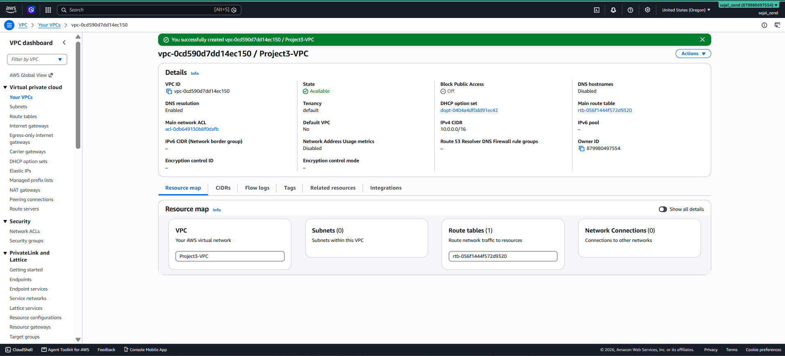

---

# 4. Subnet Configuration

Two subnets were created inside the VPC.

| Subnet | CIDR | Purpose |
|---|---|---|
| `Public-Subnet` | `10.0.1.0/24` | Hosts the public EC2 |
| `Private-Subnet` | `10.0.2.0/24` | Hosts the private EC2 |


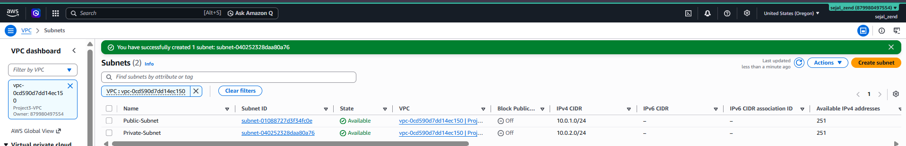

---

# 5. Internet Gateway

An Internet Gateway was created and attached to the VPC.

```text
Public Subnet
      |
      v
Internet Gateway
      |
      v
Internet
```

### Configuration

```text
Name: Project3-IGW
VPC: Project3-VPC
```

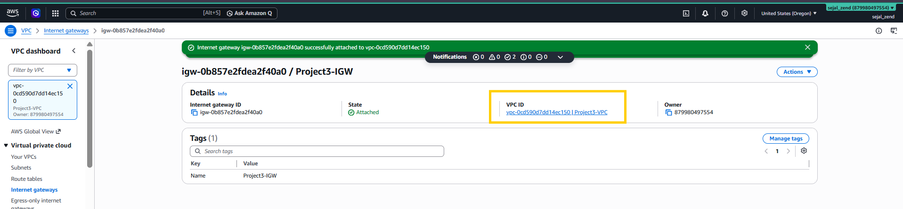

---

# 6. Public Route Table

A public route table was created and associated with the public subnet.

```text
Destination: 0.0.0.0/0
Target: Internet Gateway
```

This allows the public subnet to communicate with the internet.


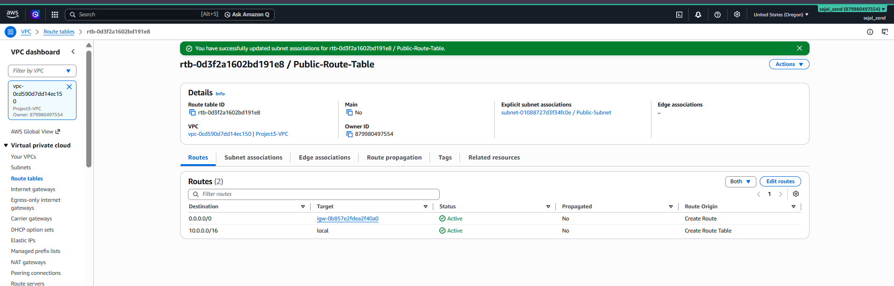

---

# 7. NAT Gateway

A NAT Gateway was created in the public subnet to provide outbound internet access to resources in the private subnet.

```text
Private EC2
     |
     v
NAT Gateway
     |
     v
Internet Gateway
     |
     v
Internet
```

### Configuration

```text
Name: Project3-NAT
Subnet: Public-Subnet
Connectivity: Public
Elastic IP: Allocated
```

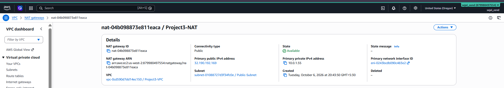

---

# 8. Private Route Table

A separate route table was created for the private subnet.

```text
Destination: 0.0.0.0/0
Target: NAT Gateway
```

The route table was associated with the private subnet.

### Screenshot

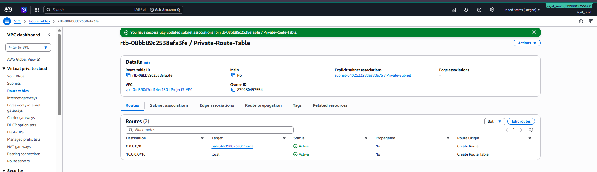

---

# 9. Security Groups

Two security groups were configured.

### Public EC2 Security Group

SSH access was allowed from the user's IP address.

```text
SSH — TCP 22 — My IP
```

### Private EC2 Security Group

SSH access was allowed from the Public EC2 security group.

```text
SSH — TCP 22 — Source: Public-EC2-SG
```

This allows controlled communication from the public EC2 to the private EC2 without exposing SSH directly to the internet.

### Screenshots

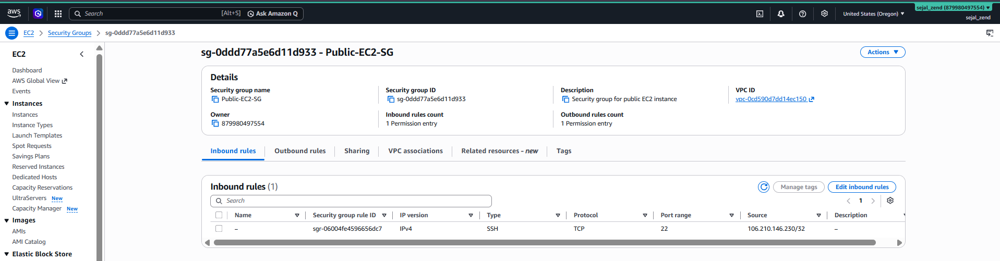

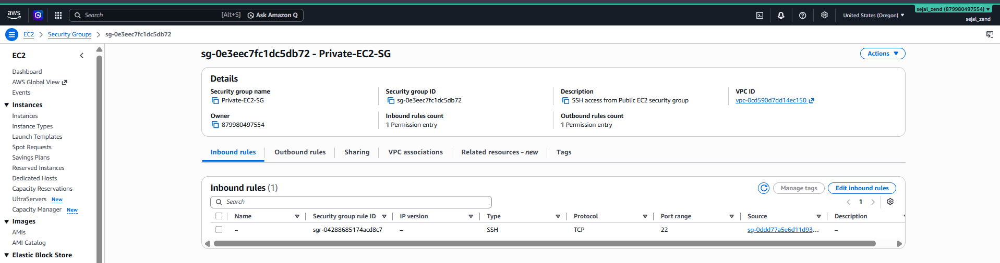

---

# 10. EC2 Instances

Two EC2 instances were launched inside the VPC.

| Instance | Subnet | Public IP |
|---|---|---|
| `Public-EC2` | Public-Subnet | Yes |
| `Private-EC2` | Private-Subnet | No |

### Screenshots

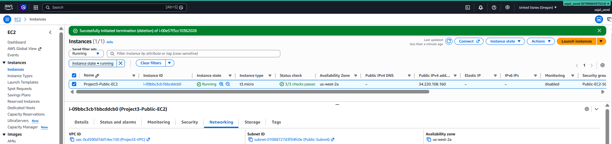

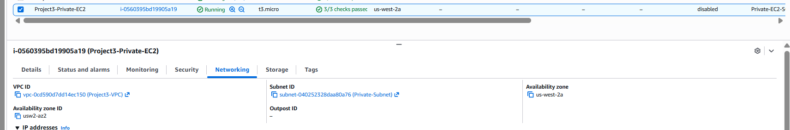

---

# 11. Connectivity Testing

## Test 1 — Public EC2 → Internet

The public EC2 was accessed through SSH and internet connectivity was tested using:

```bash
curl -I https://www.google.com
```

### Result

```text
Public EC2 → Internet
PASS
```

### Screenshot

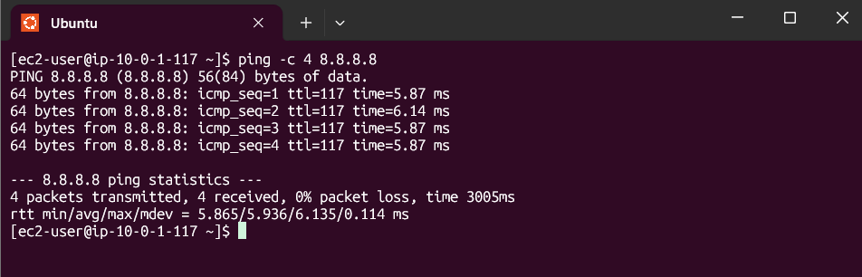

---

## Test 2 — Private EC2 → Internet

The private EC2 was accessed through the public EC2 using its private IP.

Internet connectivity was then tested from the private EC2:

```bash
curl -I https://www.google.com
```

The request completed successfully through the NAT Gateway.

### Result

```text
Private EC2 → NAT Gateway → Internet
PASS
```

### Screenshot

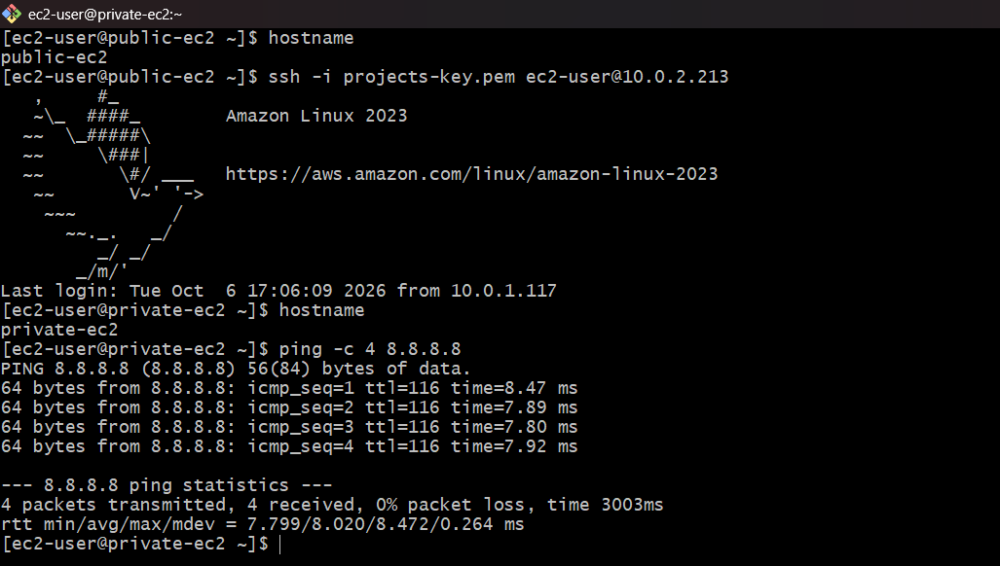

---

## Test 3 — Public EC2 → Private EC2

The public EC2 connected to the private EC2 using the private EC2's private IPv4 address.

```bash
ssh -i "key.pem" ec2-user@<PRIVATE_IP>
```

The connection was successful.

### Result

```text
Public EC2 → Private EC2
PASS
```

This confirmed communication through the VPC's private network.

### Screenshot

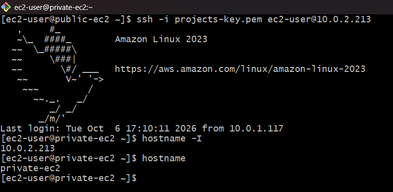

---

# 12. Security Behavior

```text
Public EC2 → Internet
        PASS

Private EC2 → Internet
        PASS
        through NAT Gateway

Internet → Private EC2
        NOT DIRECTLY ACCESSIBLE

Public EC2 → Private EC2
        PASS
        through private VPC networking
```

The private EC2 has no public IP and does not have a direct route to the Internet Gateway.

---

# 13. Conclusion

The project successfully demonstrates a secure AWS VPC containing public and private subnets.

The public EC2 has direct internet connectivity through the Internet Gateway, while the private EC2 has no public IP and accesses the internet through the NAT Gateway. Controlled communication between the public and private EC2 instances was also verified using private IP connectivity.
